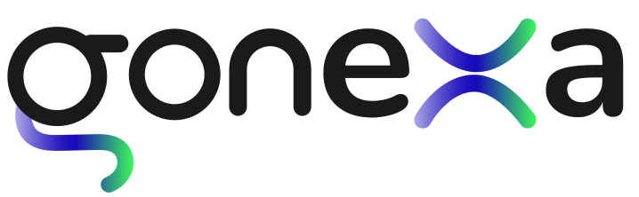

<a href="https://gonexa.io">
  <picture>
    <source media="(prefers-color-scheme: dark)" srcset="gonexa-logo-white.svg">
    
  </picture>
</a>

### Construimos herramientas para negocios que crecen

Productos propios en producción, hechos en Perú.

[Sitio web](https://gonexa.io) · [Productos](https://gonexa.io/#portafolio) · [contacto@gonexa.io](mailto:contacto@gonexa.io)

---

## Quiénes somos

Somos un equipo de tecnología de Perú que dejó de construir solo para otros y empezó a crear herramientas para los negocios que más las necesitan. No somos una agencia: diseñamos, operamos y mantenemos nuestros propios productos, y ponemos esa misma experiencia al servicio de proyectos a medida.

## Nuestros productos

| Producto | Qué resuelve |
|----------|--------------|
| [**Impulsa**](https://gonexa.io/impulsa) | Plataforma SaaS multi-tenant para gestionar un negocio: agenda, inventario, facturación y más. |
| [**Portal de Proveedores**](https://gonexa.io/portal) | Plataforma B2B para proveedores corporativos: homologación, licitaciones, facturación y evaluación. |
| [**Emite**](https://gonexa.io/emite) | Facturación electrónica ante SUNAT: genera el XML UBL 2.1, firma cada comprobante y gestiona el envío. |
| [**Sella**](https://gonexa.io/sella) | Motor de firma digital (XAdES y certificados X.509) para documentos electrónicos peruanos. |
| [**APIs SUNAT/RENIEC y Ubigeo**](https://gonexa.io/#portafolio) | Consulta de DNI, RUC y datos fiscales, y datos geográficos de Perú, listos para integrar. |
| [**izipay_sdk**](https://pub.dev/packages/izipay_sdk) | Plugin de Flutter para integrar pagos con Izipay, publicado en pub.dev. |

## Qué hacemos por encargo

- **Desarrollo a medida:** aplicaciones web y móviles adaptadas a cada negocio.
- **APIs e integraciones:** SUNAT, pasarelas de pago, ERP y servicios externos.
- **SaaS y plataformas:** productos multi-tenant listos para crecer.
- **Consultoría tecnológica:** arquitectura, nube y estrategia de escalabilidad.
- **Soporte y mantenimiento:** monitoreo, actualizaciones y respaldo continuo.

## Cómo trabajamos

Descubrimiento, diseño, desarrollo, despliegue y soporte, con entregables concretos en cada fase y sin cajas negras.

## Tecnologías con las que trabajamos

**Móvil y web** 

**Backend** 

**Datos** 

**Nube y DevOps** 

**Diseño, IA e integraciones** 

## Hablemos

Cuéntanos qué necesitas y te respondemos con claridad, sin compromiso.

**Correo:** [contacto@gonexa.io](mailto:contacto@gonexa.io) · **Web:** [gonexa.io](https://gonexa.io)

Hecho en Perú

