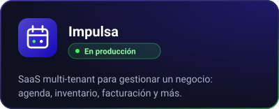
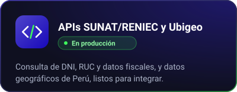
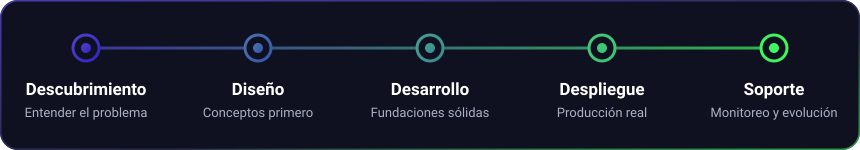
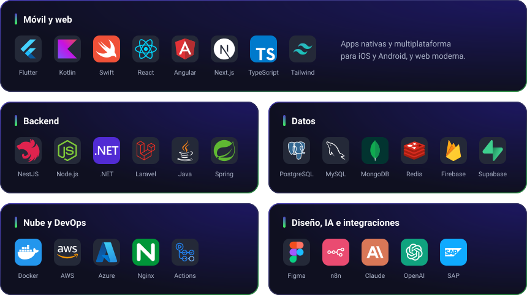

  

<h3 align="center">Construimos herramientas para negocios que crecen</h3>

Productos propios en producción, hechos en Perú.

  
  
  

## Quiénes somos

Somos un equipo de tecnología de Perú que dejó de construir solo para otros y empezó a crear herramientas para los negocios que más las necesitan. No somos una agencia: diseñamos, operamos y mantenemos nuestros propios productos, y ponemos esa misma experiencia al servicio de proyectos a medida.

## Nuestros productos

## Qué hacemos por encargo

- **Desarrollo a medida:** aplicaciones web y móviles adaptadas a cada negocio.
- **APIs e integraciones:** SUNAT, pasarelas de pago, ERP y servicios externos.
- **SaaS y plataformas:** productos multi-tenant listos para crecer.
- **Consultoría tecnológica:** arquitectura, nube y estrategia de escalabilidad.
- **Soporte y mantenimiento:** monitoreo, actualizaciones y respaldo continuo.

## Cómo trabajamos

  

Cada fase tiene entregables concretos y criterios de salida, sin cajas negras.

## Tecnologías con las que trabajamos

  

## Hablemos

Cuéntanos qué necesitas y te respondemos con claridad, sin compromiso.

  
  

Hecho en Perú

