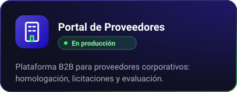
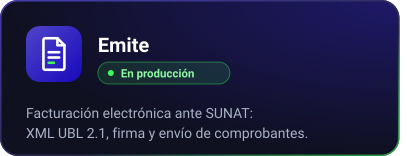
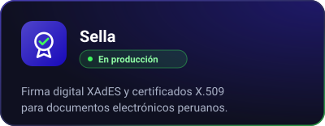
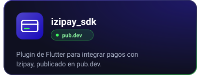

  

<h3 align="center">Construimos herramientas para negocios que crecen</h3>

Productos propios en producción, hechos en Perú.

  
  
  

## Quiénes somos

Somos un equipo de tecnología de Perú que dejó de construir solo para otros y empezó a crear herramientas para los negocios que más las necesitan. No somos una agencia: diseñamos, operamos y mantenemos nuestros propios productos, y ponemos esa misma experiencia al servicio de proyectos a medida.

## Nuestros productos

  
  
  
  
  
  

## Qué hacemos por encargo

- **Desarrollo a medida:** aplicaciones web y móviles adaptadas a cada negocio.
- **APIs e integraciones:** SUNAT, pasarelas de pago, ERP y servicios externos.
- **SaaS y plataformas:** productos multi-tenant listos para crecer.
- **Consultoría tecnológica:** arquitectura, nube y estrategia de escalabilidad.
- **Soporte y mantenimiento:** monitoreo, actualizaciones y respaldo continuo.

## Cómo trabajamos

<table width="100%">
  <tr>
    <td align="center" width="20%"><b>Descubrimiento</b> Entender el problema</td>
    <td align="center" width="20%"><b>Diseño</b> Conceptos primero</td>
    <td align="center" width="20%"><b>Desarrollo</b> Fundaciones sólidas</td>
    <td align="center" width="20%"><b>Despliegue</b> Producción real</td>
    <td align="center" width="20%"><b>Soporte</b> Monitoreo y evolución</td>
  </tr>
</table>

Cada fase tiene entregables concretos y criterios de salida, sin cajas negras.

## Tecnologías con las que trabajamos

**Móvil y web** 

**Backend** 

**Datos** 

**Nube y DevOps** 

**Diseño, IA e integraciones** 

## Hablemos

Cuéntanos qué necesitas y te respondemos con claridad, sin compromiso.

  
  

Hecho en Perú

